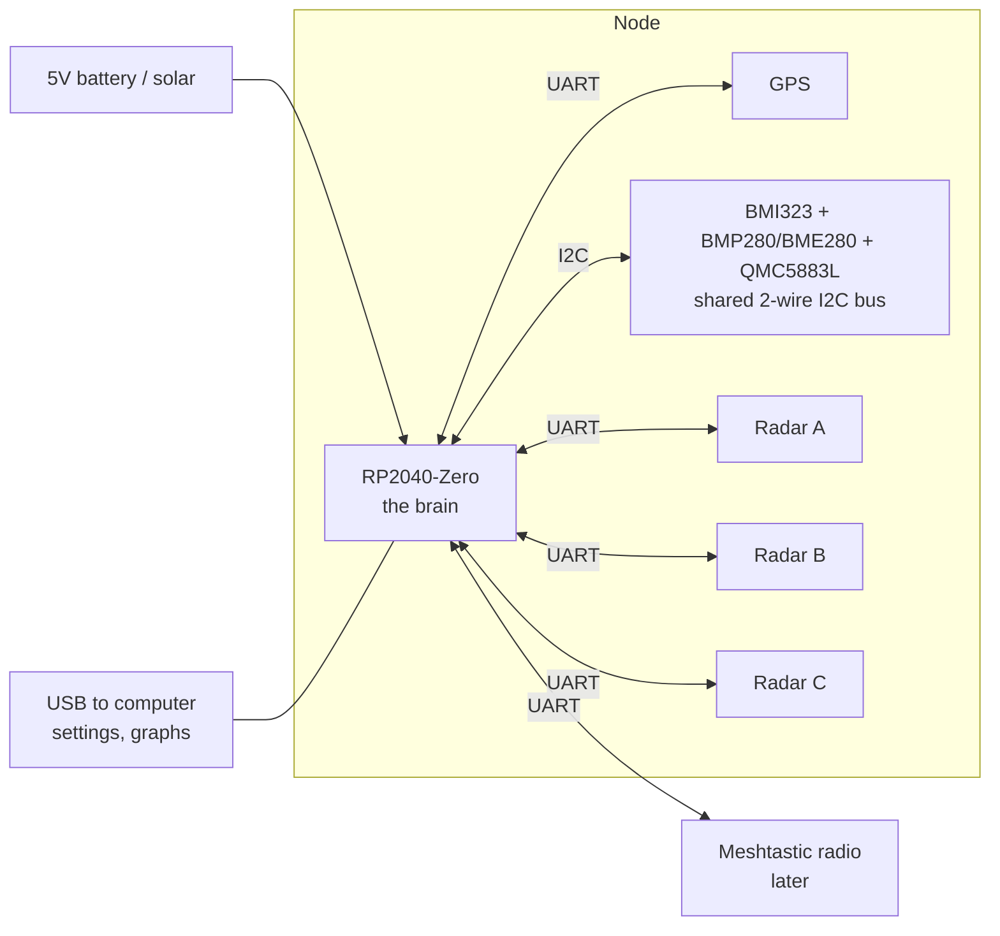

# Build guide

How to build one perimeter node from parts, with no assumptions about prior experience. Every stage ends with a **check**:
a command you type and the answer you should see. Do not move on until the check passes. That is how you find a mistake
while it is still one wire, not twelve.

> **Time:** a first build takes an afternoon. **Skill needed:** you can follow a wiring table. Soldering or wire-wrapping is
> the hardest part. **Status:** the standalone node (everything except the mesh radio link) is built and verified on a
> prototype. The mesh link is not built yet; see the [roadmap](wiki/Status-and-Roadmap.md).

## 0. What you are building



## 1. Parts and tools

| Part | Qty | Notes |
|---|---|---|
| Waveshare RP2040-Zero | 1 | With headers on **all** the pins you need (GP0-GP15 at minimum) |
| Adafruit Feather Ultimate GPS | 1 | The GPS board; its 3.3 V logic matches the RP2040 |
| BMI323 breakout | 1 | Pins: VCC GND SCL SDA SAO CS INT1 INT2 |
| BMP280 breakout (BME280 later) | 1 | The BME280 is a drop-in upgrade |
| QMC5883L breakout | 1 | Compass |
| HLK-LD2410C radar | 3 | 4 pins each: 5V, GND, TX, RX |
| Perfboard or wire-wrap board, wire | - | Short wires; use different colours for 3V3, 5V, GND, signals |
| 5 V power source | 1 | USB for bench work; battery or solar charger for the field |
| USB data cable (not charge-only) | 1 | USB-C for the RP2040-Zero |
| Meshtastic radio (XIAO nRF52840 or RAK) | 1 | **Later** - not needed to build and test the node |

Tools: soldering iron or wire-wrap tool, multimeter (strongly recommended), a computer with Chrome or Edge.

**Safety:** the radars need 5 V and everything else needs 3.3 V. Connecting 5 V to a 3.3 V pin can destroy a sensor.
Power the board off while wiring.

## 2. Install the software

1. Install [VS Code](https://code.visualstudio.com) and its **PlatformIO** extension (or the PlatformIO command-line tool).
2. Get this project (`git clone`, or download the zip) and open the folder.
3. Build it: `pio run`. The first build downloads the toolchain and takes several minutes.
   The result is `.pio/build/rp2040zero/firmware.uf2`.

*Check:* the build ends with `SUCCESS`.

## 3. Flash the RP2040-Zero (do this before wiring)

Flashing the bare board first proves the brain works before anything else can confuse things.

1. Hold the **BOOT** button on the RP2040-Zero, plug in the USB cable, then release the button.
2. A drive named **RPI-RP2** appears. Copy `firmware.uf2` onto it. The drive vanishes and the board restarts by itself.
3. Open a serial terminal at **115200 baud** (VS Code: `pio device monitor`), or use the [web app](wiki/Webapp.md).

*Check:* type `ver`. You should see `perimeter-sensor 0.1.0-dev (built ...)` then `OK`.
Type `status`: you get an uptime and a temperature. The onboard LED blinks green once a second.

*Later updates:* type `bootsel` in the terminal (or use Tools in the web app) to re-enter the bootloader without the button.

## 4. Power wiring

| From | To |
|---|---|
| 5 V source + | RP2040-Zero **5V** pin, and **+5V** on all three radars |
| 5 V source - | RP2040-Zero **GND**, and GND on every module |
| RP2040-Zero **3V3** | VCC of the BMI323, BMP280/BME280, QMC5883L; and the GPS **3V** pin |

Build a common ground: every module's GND connects to the same GND rail.

*Check (multimeter):* with power on, 5 V between the 5V rail and GND, 3.3 V between the 3V3 rail and GND. If either is wrong,
switch off and fix it before connecting anything else.

## 5. The I2C sensors

Three sensors share two wires. Connect **in parallel** (all SDAs together, all SCLs together).

| RP2040-Zero | Connects to |
|---|---|
| **GP2** | SDA on the BMI323, BMP280/BME280 and QMC5883L |
| **GP3** | SCL on all three |

Set the strap pins (these are not connections to the RP2040):

| Module | Pin | Connect to | Why |
|---|---|---|---|
| BMI323 | **CS** | **3V3, permanently** | Tells it to use I2C. Left floating, it can lock into the wrong mode |
| BMI323 | SAO | GND | Address 0x68 |
| BMP280 / BME280 | SDO | GND | Address 0x76 |

If your breakouts do not already include I2C pull-up resistors, add a 4.7 kOhm resistor from SDA to 3V3 and from SCL to 3V3 (once per bus, not per sensor).

Optional now, handy later: BMI323 INT1 to **GP8**, INT2 to **GP9**; QMC5883L DRDY to **GP27**.

*Check:* type `reboot`, wait 3 seconds, reconnect, then type `i2cscan`. You should see:

```
0x0D QMC5883L
0x68 BMI323 (SAO)
0x76 BMP280/BME280
3 device(s)
```

Then `env`, `imu` and `mag` should each print readings. Tip: wire and test **one sensor at a time**. If something is missing
the error message names what to check. Note: the I2C sensors are detected only at start-up, so `reboot` after wiring each one.

## 6. The GPS

| RP2040-Zero | GPS Feather |
|---|---|
| **GP0** | **RX** (the board's TX goes to the GPS's RX) |
| **GP1** | **TX** (the GPS's TX comes to the board's RX) |
| GP6 | **PPS** (optional; 1-second pulse) |
| GP7 | **EN** (optional; see warning) |
| 3V3 / GND | **3V** / **GND** |

> **EN warning:** on this GPS, EN is "active-low-enabled": **LOW (or unconnected) = on, HIGH = off.** The firmware already
> drives it correctly. If you wire EN to something else, do not hold it high.

*Check:* `gps`. Within a second you should see `nmea_ok=` counting up. That means wiring and speed are right.
Indoors it will say `fix=0`; that is normal. Take it near a window or outside with a clear sky. Within a few minutes you should see
`fix=1`, a satellite count and your position; `pps` counts up once a second.

## 7. The radars (do one at a time)

Each radar has 4 pins: 5V, GND, TX, RX. **The serial wires cross over:** the board's *transmit* goes to the radar's *receive*.

| Radar | RP2040-Zero pin | Radar pin |
|---|---|---|
| A | **GP10** (board TX) | **RX** |
| A | **GP11** (board RX) | **TX** |
| B | **GP12** | **RX** |
| B | **GP13** | **TX** |
| C | **GP14** | **RX** |
| C | **GP15** | **TX** |

All three radars: 5V to the 5V rail, GND to GND.

*Check (per radar):* type `radar`. The radar you just wired should show `online=1` and a `frames=` number that climbs.
Then `radar ver a` (or b, c) should print a version like `V2.44...`. That proves **both** directions work.
Wave a hand in front of it and watch `present=1` and the distances change.

## 8. Placing the radars and sensors

- **Three radars, 120 degrees apart,** like the points of a Mercedes badge, each facing outward. In the firmware, radar A is the
  front (0 degrees), B is 120 degrees clockwise, C is 240 degrees. Mark "front" on your enclosure.
- Keep each radar's front face **clear**: plastic is fine, metal and foil block it. Do not stack a battery or board in front of it.
- Mount the **compass (QMC5883L)** as far as practical from the radar power wires, speakers, magnets and steel screws.
- Mount the **accelerometer (BMI323)** rigidly to the enclosure so it feels the same movement as the box.
- Mount the **GPS** with the patch antenna facing the sky and nothing metal above it.
- The radars sit close together at 24 GHz. If they seem to trigger each other, spread them out a little and see
  [Troubleshooting](wiki/Troubleshooting.md).

## 9. First calibration and tuning

1. **Compass:** with the node fully assembled, `magcal start`, slowly rotate the whole unit through every orientation for about
   20 seconds (a figure-8, then tip it onto each side), then `magcal stop`, then `save`. Set your local declination with
   `set mag.declination_deg <degrees>` (east is positive), then `save`.
2. **Tamper:** place the node where it will live, then `arm`. Gently tilt it: after the tilt limit (default 15 degrees, held
   half a second) you should see `ALARM` with `imu`. Tune with `tamper.*` settings.
3. **Radars:** watch `radar` or the web app while someone walks around. Raise `radar.min_energy` if you get false hits; lower
   `radar.max_cm` to ignore distant movement. To change the sensitivity *inside* each radar module, set `radar.sens_move` /
   `radar.sens_static`, then run `radar apply`.
4. **Keep your settings:** `save`. While there are unsaved changes the status LED is orange.

The [web app](wiki/Webapp.md) does all of this with graphs and a settings page, which is far easier than typing.

## 10. The Meshtastic radio (later)

Reserved pins: **GP4** (board TX) to the radio's RX, **GP5** (board RX) from the radio's TX, plus a common GND. The firmware side is not
written yet; see the [mesh protocol draft](wiki/Mesh-Protocol-DRAFT.md). It is fine to leave this unconnected while you build
and test everything else.

## 11. If something does not work

See [Troubleshooting](wiki/Troubleshooting.md). The three most common first-build problems:

1. **A sensor says "not found":** a strap is wrong (BMI323 CS to 3V3!), SDA/SCL swapped, or you did not `reboot` after wiring.
2. **GPS silent:** EN held high, or TX/RX swapped.
3. **Radar `online=0`:** missing 5 V or ground, or TX/RX not crossed.

## Final checklist

- [ ] `ver` answers; LED blinks
- [ ] `i2cscan` shows 0x0D, 0x68, 0x76
- [ ] `env`, `imu`, `mag` give sensible readings
- [ ] `gps` shows NMEA, and a fix outdoors
- [ ] `radar` shows three radars online; `radar ver a|b|c` all answer
- [ ] Compass calibrated and saved
- [ ] Tamper armed and tested by tilting
- [ ] Settings saved (LED not orange)
